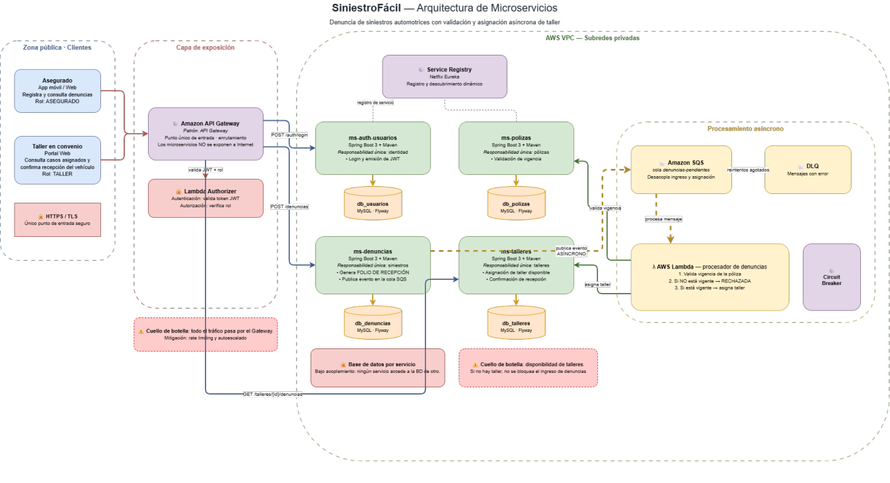

# SiniestroFácil — Microservicios

Plataforma de denuncia de siniestros automotrices con validación de póliza y asignación asíncrona de taller.

**Asignatura:** JVY0101 · Java: Diseño y Construcción de Soluciones Nativas en Nube — Duoc UC
**Evaluación Parcial N°2:** desarrollo de los microservicios diseñados en la Evaluación Parcial N°1.
**Integrantes:** Nicolás López · Pablo Velásquez



## 1. Qué resuelve

El asegurado denuncia un siniestro desde la app y un taller en convenio recibe el vehículo. Como un taller no siempre está disponible, **el ingreso de la denuncia y la asignación del taller son procesos independientes**:

1. `ms-denuncias` guarda la denuncia y devuelve de inmediato un **folio de recepción** (estado `RECIBIDA`).
2. Publica el evento *DenunciaRegistrada* en la cola `denuncias-pendientes`.
3. El procesador (Lambda en AWS) valida la vigencia en `ms-polizas`:
   - no vigente → `RECHAZADA`
   - vigente → pide un taller a `ms-talleres` → `TALLER_ASIGNADO`
   - sin talleres disponibles → `PENDIENTE_TALLER` (se reintenta, no bloquea nuevas denuncias)
4. El taller consulta sus casos y confirma la recepción del vehículo.

## 2. Microservicios

| Microservicio | Puerto | Base de datos | Responsabilidad única |
|---|---|---|---|
| [`ms-auth-usuarios`](ms-auth-usuarios) | 8081 | `db_usuarios` | Identidad: registro, login, emisión y validación de JWT, roles |
| [`ms-polizas`](ms-polizas) | 8082 | `db_polizas` | Pólizas: catálogo, coberturas y validación de vigencia |
| [`ms-denuncias`](ms-denuncias) | 8083 | `db_denuncias` | Siniestros: registro, folio, fotos y procesamiento |
| [`ms-talleres`](ms-talleres) | 8084 | `db_talleres` | Red de talleres: disponibilidad, asignación y recepción |

Cada microservicio es un proyecto Maven independiente con su propio `pom.xml`, Maven Wrapper (`mvnw`), base de datos y migraciones Flyway. **Ningún servicio accede a la base de datos de otro**: se comunican solo por HTTP.

### Del diseño (EP1) a la implementación local (EP2)

| Componente del diagrama | Implementación local |
|---|---|
| Microservicios Spring Boot 3 + Maven | Los 4 proyectos de este repositorio (Spring Boot 3.5.6, Java 21) |
| MySQL · Flyway (una BD por servicio) | MySQL 8 (`docker-compose.yml`) + migraciones en `src/main/resources/db/migration` |
| Lambda Authorizer (valida JWT + rol) | `GET /api/v1/auth/validar` en `ms-auth-usuarios` |
| Amazon SQS `denuncias-pendientes` | `PublicadorEventos` (en local registra el evento en el log) |
| AWS Lambda procesador de denuncias | `ProcesadorDenunciasService` + `POST /api/v1/procesador/...` en `ms-denuncias` |
| Circuit Breaker / DLQ | Timeouts de 2–3 s en los clientes HTTP; si `ms-talleres` falla la denuncia queda `PENDIENTE_TALLER` en vez de fallar |
| API Gateway, Service Registry | Componentes de infraestructura AWS; fuera del alcance de la ejecución local |

## 3. Arquitectura interna de cada servicio

```
src/main/java/cl/duoc/siniestrofacil/<servicio>/
├── controller/   Controladores REST (@RestController), solo HTTP
├── service/      Lógica de negocio (interfaz + implementación, @Transactional)
├── repository/   Interfaces Spring Data JPA
├── model/        Entidades JPA (@Entity) y relaciones
├── dto/          Records de entrada/salida con Bean Validation
├── exception/    Excepciones de negocio y @RestControllerAdvice
└── config/       Beans de configuración (cuando aplica)
```

Relaciones JPA implementadas:

| Servicio | Relación |
|---|---|
| ms-auth-usuarios | `Rol` 1 — N `Usuario` (`@OneToMany` / `@ManyToOne`) |
| ms-polizas | `Poliza` 1 — N `Cobertura` (cascade + orphanRemoval) |
| ms-denuncias | `Denuncia` 1 — N `Foto` (cascade + orphanRemoval) |
| ms-talleres | `Taller` 1 — N `Asignacion` |

Las respuestas de error usan siempre el mismo formato JSON con su código HTTP (`400` validación, `401` credenciales, `404` no existe, `409` regla de negocio, `503` dependencia caída).

## 4. Ejecución local

### Requisitos

- JDK 21 o superior (`java -version`)
- MySQL 8 en `localhost:3306` con usuario `root` / clave `root`, **o** Docker Desktop
- Git y Postman
- No es necesario instalar Maven: cada servicio incluye `mvnw`

### Paso 1 — Clonar

```bash
git clone https://github.com/NicoLB24/SiniestroFacil.git
cd SiniestroFacil
```

### Paso 2 — Levantar MySQL

Con Docker:

```bash
docker compose up -d
```

Sin Docker, basta con tener MySQL corriendo: cada servicio crea su base con `createDatabaseIfNotExist=true` y Flyway crea las tablas y datos de prueba. Si tu usuario o clave no son `root`/`root`, usa las variables `DB_USERNAME` y `DB_PASSWORD`.

### Paso 3 — Compilar, probar y empaquetar (por servicio)

```bash
cd ms-polizas
./mvnw clean install        # compila, ejecuta las pruebas y genera target/ms-polizas.jar
```

En Windows (cmd/PowerShell) usar `mvnw.cmd clean install`.

Comandos Maven útiles:

| Comando | Qué hace |
|---|---|
| `./mvnw clean` | Borra `target/` |
| `./mvnw compile` | Compila el código |
| `./mvnw test` | Ejecuta las pruebas (JUnit 5 + MockMvc sobre H2 con las mismas migraciones Flyway) |
| `./mvnw package` | Genera el `.jar` ejecutable en `target/` |
| `./mvnw install` | Igual que package y lo instala en el repositorio local `~/.m2` |
| `./mvnw spring-boot:run` | Ejecuta el servicio sin generar el jar |

### Paso 4 — Ejecutar los 4 servicios (una terminal por servicio)

```bash
java -jar ms-auth-usuarios/target/ms-auth-usuarios.jar
java -jar ms-polizas/target/ms-polizas.jar
java -jar ms-talleres/target/ms-talleres.jar
java -jar ms-denuncias/target/ms-denuncias.jar
```

Verificar que están arriba: `http://localhost:808X/actuator/health` → `{"status":"UP"}`.
Documentación interactiva de cada API: `http://localhost:808X/swagger-ui.html`.

### Paso 5 — Probar con Postman

Importar [`postman/SiniestroFacil.postman_collection.json`](postman/SiniestroFacil.postman_collection.json) y ejecutar las carpetas en orden (1 → 4). La colección trae 52 peticiones con casos correctos y de error, y guarda automáticamente el token, los ids y el folio en variables.

## 5. Datos de prueba

**Usuarios** (los crea `ms-auth-usuarios` al iniciar por primera vez):

| Email | Contraseña | Rol |
|---|---|---|
| `admin@siniestrofacil.cl` | `Admin123` | ADMIN |
| `juan.perez@mail.cl` | `Clave123` | ASEGURADO (RUT 12345678-9) |
| `maria.gonzalez@mail.cl` | `Clave123` | ASEGURADO (RUT 11111111-1) |
| `taller.central@mail.cl` | `Clave123` | TALLER (taller id 1) |

**Pólizas:** `POL-1001` y `POL-1002` vigentes · `POL-1003` vencida · `POL-1004` inactiva.
**Talleres:** 3 activos (Santiago, Ñuñoa, Maipú) y 1 inactivo (La Florida).

## 6. Endpoints principales

| Método | Ruta | Servicio | Descripción |
|---|---|---|---|
| POST | `/api/v1/auth/registro` | auth | Registrar usuario |
| POST | `/api/v1/auth/login` | auth | Login, devuelve JWT |
| GET | `/api/v1/auth/validar` | auth | Validar token (`Authorization: Bearer`) |
| GET/PUT/DELETE | `/api/v1/usuarios[/{id}]` | auth | CRUD de usuarios |
| GET | `/api/v1/roles` | auth | Listar roles |
| GET/POST/PUT/DELETE | `/api/v1/polizas[/{id}]` | polizas | CRUD de pólizas |
| GET | `/api/v1/polizas/numero/{numero}/vigencia` | polizas | Validar vigencia |
| GET/POST/PUT/DELETE | `/api/v1/talleres[/{id}]` | talleres | CRUD de talleres |
| GET | `/api/v1/talleres/{id}/denuncias` | talleres | Casos asignados a un taller |
| POST | `/api/v1/asignaciones` | talleres | Asignar taller disponible |
| PUT | `/api/v1/asignaciones/{id}/recepcion` | talleres | Confirmar recepción del vehículo |
| GET/POST/PUT/DELETE | `/api/v1/denuncias[/{id}]` | denuncias | CRUD de denuncias (POST devuelve folio) |
| GET | `/api/v1/denuncias/folio/{folio}` | denuncias | Consultar por folio |
| PATCH | `/api/v1/denuncias/{id}/estado` | denuncias | Actualizar estado |
| POST | `/api/v1/procesador/denuncias/{id}` | denuncias | Validar póliza y asignar taller |

El detalle de cada servicio está en su propio `README.md`.

## 7. Flujo de trabajo Git

- `main`: versión estable entregada.
- `develop`: integración de funcionalidades terminadas.
- `feature/<nombre>`: una rama por funcionalidad, se integra a `develop` con merge `--no-ff`.

Mensajes de commit con el formato [Conventional Commits](https://www.conventionalcommits.org/es/): `feat:`, `fix:`, `test:`, `docs:`, `build:`, `chore:`.
